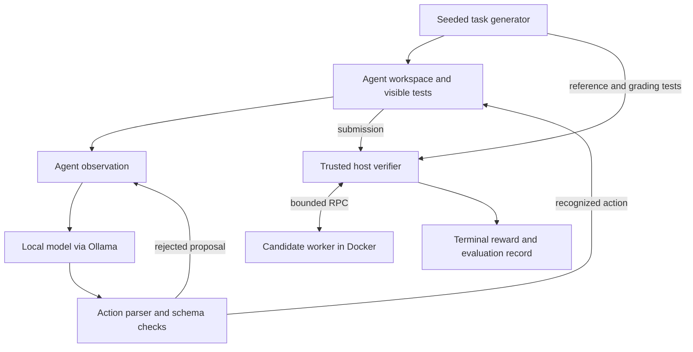

# BugForge 2.0

BugForge is a Python environment for evaluating coding agents on seeded, multi-file repairs. An agent receives a repository, a task description and six tools. A separate verifier grades the submitted code. The evaluation records what the model proposed, what the harness executed and what the submission achieved.

**What the evaluation found.** Qwen2.5-Coder 1.5B completed all six guided text-tool tasks with explicit instructions at both tested context sizes. On a separate autonomous checkout task, it repeatedly passed a filename to an argument-free tool. Both prompt conditions ended with an automatic submission, zero edits and zero reward. This repository includes the records behind that distinction.

[Evaluation protocol](PROTOCOL.md) · [Dataset and field guide](dataset/README.md) · [Diagnostic driver](diagnostic.py)

## Architecture and trust boundaries



The agent can list or read files, write or replace text, run visible tests and submit. The host owns the reference implementation, hidden tests, fuzz inputs and grading report. In Docker split verification, the host runs trusted pytest code and exchanges typed values with the candidate worker. Candidate code runs with networking disabled, a read-only container root, an unprivileged user and resource limits. The candidate workspace used for editing has different write permissions from the grading worker.

“Hidden” describes the episode interface: the model receives the task and visible tests only. Researchers can inspect the published verifier and fixtures. Local execution is available for trusted controls. Docker isolation, input validation and grading checks reduce risk; this project makes no formal sandbox-security claim.

## Tasks and rewards

The repository-task generator chooses two curated defects in different source files and selects visible tests, including witnesses for the defects. A seed and family identify a generation request; a content hash identifies the resulting workspace and reference. Distinct seeds can yield the same task.

| Family | Example repair contract |
|---|---|
| Checkout | Aggregate repeated SKUs, compute a member discount in integer cents and preserve input stock. |
| Ledger | Replay transfers against opening balances while enforcing transaction and balance rules. |
| Numerical | Fit statistics on training observations, impute missing values and transform inference data. |
| API migration | Validate two profile schemas and convert records between versions. |
| Scheduler | Respect job dependencies, priority and retry limits in a deterministic schedule. |
| Reconciliation | Apply payments to invoices and compute outstanding balances in integer cents. |

Each action yields an observation. Submission or exhaustion of the action budget triggers grading. The reported experiments used a binary terminal reward: one for a valid full solve and zero for an unsuccessful graded submission. The verifier applies source-policy checks and checks expected test counts, exit status and fuzz outcomes. The diagnostic driver records incomplete verification as an execution problem. Action parsing failures occur earlier and can leave the tool-execution error counter at zero.

## Validation and results

The Phase 13 build passed **482 tests with zero failures, errors or skips in 311.87 seconds** on the local Docker-enabled machine. **Nine diagnostic checks** subsequently passed with trusted fixtures in a separate run. The final Docker controls also confirmed that the defective submission scored zero and the privileged reference scored one. These are implementation and verifier checks.

| Evaluation | Unit | Observation |
|---|---|---|
| Historical pilot | Six families, one seed each | 0/6 solved. Four explicit submissions and two automatic submissions. |
| Historical trace review | 19 episodes, including opening, pilot and UCB1 | 40 assistant turns: 21 unknown tool names, two JSON parsing failures and 17 recognized submissions. Zero edits and zero agent-initiated tests. |
| Guided text tools | Six tasks per prompt at 4,096 and 8,192 tokens | Original prompt 5/6 at each size; explicit prompt 6/6 at each size. Only the guided read changed. |
| Guided native tools | Six tasks, explicit prompt, 4,096 tokens | 0/6 structured calls. Ollama advertised tool support. The read reply contained the action in ordinary message text. |
| Final autonomous pilot | Two prompts on one identical checkout task, seed 1 | Both scored zero. Each ended after three rejected proposals and automatic submission. |

The historical UCB1 selector sampled two repair instructions four times each. All eight rewards were zero. The tie selected the baseline, so the four holdout differences were zero by construction. Model weights remained frozen. The 3B model was absent from the recorded setup. This study covers only the 1.5B model. The existing repository also contains legacy runs from earlier development under `runs/`. Those logs are outside this release dataset.

## Reproduction

**Inspect the recorded evidence without inference.** Open the CSV and JSON files under `dataset/`. Join historical tables by `episode_id`. The final diagnostic lives in its own JSON files. The historical package version in `pyproject.toml` is 0.1.0; BugForge 2.0 is the project release label.

**Recreate the environment for an independent run.** The recorded setup used Python 3.13 on Windows, Docker Desktop with Linux containers and a local Ollama installation. From a checkout of this repository, use PowerShell:

```powershell
python -m venv .venv
& .\.venv\Scripts\python.exe -m pip install -e ".[dev]"
docker build -t bugforge-sandbox docker
& .\.venv\Scripts\python.exe -m pytest -q
& .\.venv\Scripts\python.exe -m pytest -q diagnostic_tests
```

For the bounded model diagnostic, start the local Ollama service, make the recorded tag available and run the launcher. Model acquisition requires disk space and network access. The launcher uses the project virtual environment or accepts an explicit interpreter with `-Python`.

```powershell
ollama pull qwen2.5-coder:1.5b
.\Run-Diagnostic.ps1
```

Use `-ControlsOnly` for trusted local controls without model inference. The normal launcher writes **private** traces and a ZIP under the current user's Documents folder. Compare the model and image digests with the released conditions: rebuilding a tag can change its contents. Run time, host memory and model outputs can also vary.

## Limitations and future work

The original pilot has one seed per family. The final autonomous comparison has one paired task and fixed execution order. Guided probes request a specific behavior and score the schema and observed effect. Their scores do not estimate end-to-end repair performance. Host telemetry includes other processes. A useful follow-up would counterbalance prompt order and examine additional held-out tasks with a stable tool protocol. A larger model would require a separate, resource-qualified evaluation.

## Authorship and license

Tobias Hopf developed and evaluated BugForge with AI coding assistance. The work covers task generation, test and verifier design, local experiment execution and trace analysis. The adaptive component selects prompts from terminal rewards. The project reports inference with frozen Qwen weights. Code and the accompanying measurement release retain the [MIT license](LICENSE).
